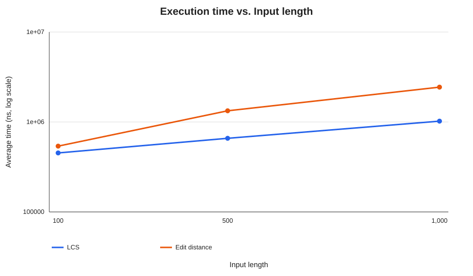
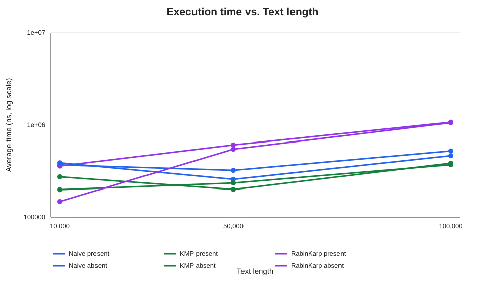
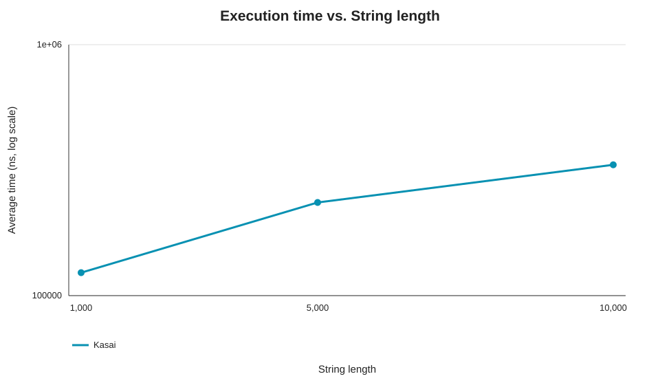

# Assignment 4: Text analysis algorithms

## Problem and algorithms

This project uses Java to study common text-processing tasks. It implements two dynamic programming problems, three string search algorithms, and Kasai's algorithm for building a longest common prefix array from a supplied suffix array.

- **Longest Common Subsequence (LCS):** Finds the length of the longest sequence of characters that appears in both strings in the same order. The characters do not need to be next to each other.
- **Edit distance:** Finds the fewest insertions, deletions, and substitutions needed to change one string into another.
- **Naive matching:** Checks the pattern at each possible starting position in the text.
- **Knuth-Morris-Pratt (KMP):** Uses a prefix table, also called an LPS table, to avoid checking characters that are already known to match.
- **Rabin-Karp:** Compares rolling hashes for text windows and checks the actual characters when the hashes match.
- **Kasai LCP:** Builds the longest common prefix array in linear time when given a string and its suffix array.

## Implementation decisions and assumptions

LCS and edit distance use a two-dimensional table. A table entry describes a pair of prefixes of the input strings, so the answer is in the bottom-right cell. Both methods return the length or distance, not a reconstructed subsequence or edit sequence.

For LCS, let `L[i][j]` be the LCS length for the first `i` characters of the first string and the first `j` characters of the second string. The base cases are `L[i][0] = 0` and `L[0][j] = 0`. If the last characters match, `L[i][j] = L[i-1][j-1] + 1`; otherwise, `L[i][j] = max(L[i-1][j], L[i][j-1])`. Matching final characters can extend the best solution for the shorter prefixes. When they differ, a best solution must leave out one of those final characters, so the table takes the better of the two remaining prefix pairs.

For edit distance, let `D[i][j]` be the minimum edits to change the first `i` characters into the first `j` characters. The base cases are `D[i][0] = i` and `D[0][j] = j`. The recurrence is `D[i][j] = min(D[i-1][j] + 1, D[i][j-1] + 1, D[i-1][j-1] + cost)`, where `cost` is zero when the last characters match and one otherwise. The final step of any conversion either deletes a character, inserts one, or matches/substitutes one, so taking the least of those costs gives the optimal answer.

KMP's LPS value at a pattern position is the length of the longest proper prefix of the pattern up to that position that is also a suffix. After a mismatch, KMP uses that length to keep the part of the match that may still be useful.

The three matching methods return a `MatchResult`. Its index list contains every match, including overlapping matches, and it records character comparisons. An empty pattern is defined to match at every position from `0` through `text.length()`. A pattern longer than the text has no matches. `null` text or pattern values are rejected.

Rabin-Karp uses a polynomial rolling hash with base `257` and modulus `1,000,000,007`. A hash match is only a candidate: the method compares the actual characters before reporting an occurrence. This check prevents hash collisions from becoming false matches.

Kasai's method expects a suffix array sorted in lexicographic order. It checks that the array has one valid entry for every suffix start, but it does not check the sort order. Suffix-array construction is outside the required algorithm. The benchmark creates one before timing Kasai.

Java's `String.length()` and `charAt()` work with UTF-16 code units. The match indices and lengths in this project use those units.

## Complexity analysis

Let `m` and `n` be the lengths of the two strings for LCS and edit distance. For string matching, `n` is the text length and `m` is the pattern length. Let `z` be the number of returned match indices. Space below is auxiliary space and excludes the returned result list or array unless stated otherwise.

| Algorithm | Main operation or recurrence | Best time | Worst time | Auxiliary space | Why |
|---|---|---:|---:|---:|---|
| LCS | If the last characters match, use the diagonal cell plus one; otherwise take the larger of the top and left cells. | `Θ(mn)` | `Θ(mn)` | `Θ(mn)` | The implementation fills one table cell for every pair of non-empty prefixes. |
| Edit distance | Take the minimum cost of deleting, inserting, or substituting the last character; matching characters have substitution cost zero. | `Θ(mn)` | `Θ(mn)` | `Θ(mn)` | The implementation fills the full table; initializing its first row and column adds `O(m+n)`. |
| Naive matching | Compare the pattern from each possible text position until a mismatch or a full match. | `Θ(n-m+1)` when `m ≤ n` | `Θ((n-m+1)m)`, or `O(nm)` | `O(1)` | In the best case, each alignment fails on the first character. In the worst case, many characters match before each mismatch. The result list needs `O(z)` space. |
| KMP | Build the LPS table, then scan the text and fall back through LPS values after mismatches. | `Θ(n+m)` | `Θ(n+m)` | `Θ(m)` | Each text position and pattern position is advanced or moved back through a stored prefix length a limited number of times. The result list needs `O(z)` space. |
| Rabin-Karp | Hash the pattern and first window, update the window hash, then verify characters for equal hashes. | `Θ(n+m)` | `O(nm)` | `O(m)` | Rolling through windows takes linear time. If many windows have the pattern hash, verifying them can take `O(m)` each. This implementation also creates an initial substring of length `m`. The result list needs `O(z)` space. |
| Kasai LCP | Use the suffix array to map each suffix start to its rank, compare it with the previous suffix, and reuse the previous common-prefix length minus one. | `Θ(n)` | `Θ(n)` | `Θ(n)` | Rank construction and the main pass are linear. Reusing the known prefix prevents the character comparisons from growing beyond a linear total. |

For Rabin-Karp, expected search time is `O(n+m)` when hash matches are uncommon. Its worst case is `O(nm)` if many windows have the same hash as the pattern and require long verification. The hash check is not proof that two strings are equal, so exact character verification is needed.

The bounds describe growth as inputs get larger. They are separate from the measured times below, which depend on the JVM, computer, and generated data.

## Testing

The test programs are simple Java `main` classes, so no external testing library is needed.

- `DynamicProgrammingTests` checks LCS with identical strings, different strings, an empty string, and a known example. It checks edit distance for identical and empty strings, and for substitution, insertion, deletion, and the `kitten` to `sitting` example.
- `StringMatchingTests` checks matches at the beginning, middle, and end; multiple and overlapping matches; an absent pattern; a pattern longer than the text; and the chosen empty-pattern behavior. Each case compares the index lists from all three algorithms. A special case gives Rabin-Karp two different strings with the same hash and checks that it does not report a false match.
- `KasaiLcpTests` uses `banana`, checks the expected LCP array, accepts an empty string, and rejects suffix arrays with the wrong length, duplicate entries, or an out-of-range index.

## Experimental setup

The benchmark uses the fixed seed `420261108` and the alphabet `ACGT`. LCS and edit distance use two generated strings of equal length at 100, 500, and 1,000 characters. Both algorithms receive the same pair at each length.

For string matching, the text lengths are 10,000, 50,000, and 100,000 characters. Each text is generated once and reused by Naive, KMP, and Rabin-Karp. The present pattern is a 12-character substring of the text. The absent pattern is generated from the same alphabet and checked against the text before timing. Each size has one present and one absent case.

Kasai uses generated strings of lengths 1,000, 5,000, and 10,000. A suffix array is made before timing by sorting the suffix starting positions lexicographically. This setup helper is not included in Kasai's execution time; only `KasaiLcp.build` is timed.

Each algorithm has five warm-up calls followed by five measured runs. The average measured duration uses `System.nanoTime()`. String generation, absent-pattern selection, suffix-array construction, console output, and writing the CSV are outside the timed regions.

The DP operation count is the number of interior table cells filled (`n × n` for the equal-length experiments). Naive counts text-pattern character comparisons. KMP counts comparisons in both LPS preprocessing and the text scan. Rabin-Karp counts character comparisons used to verify hash matches; the count does not include rolling-hash arithmetic or the hash check at each window. Kasai counts character comparisons while forming the LCP array. A `-` in the tables means a match count does not apply.

## Results

The CSV stores average time in nanoseconds. The tables below convert it to milliseconds. The same data is in [`results/tables/benchmark.csv`](results/tables/benchmark.csv).

### LCS and edit distance

| String length | Algorithm | Average time (ms) | DP cells filled |
|---:|---|---:|---:|
| 100 | LCS | 0.452992 | 10,000 |
| 100 | Edit distance | 0.539233 | 10,000 |
| 500 | LCS | 0.658900 | 250,000 |
| 500 | Edit distance | 1.331408 | 250,000 |
| 1,000 | LCS | 1.022058 | 1,000,000 |
| 1,000 | Edit distance | 2.439783 | 1,000,000 |



### String matching

| Text length | Pattern case | Algorithm | Average time (ms) | Character comparisons | Matches |
|---:|---|---|---:|---:|---:|
| 10,000 | Present | Naive | 0.369508 | 13,333 | 1 |
| 10,000 | Present | KMP | 0.274817 | 12,501 | 1 |
| 10,000 | Present | Rabin-Karp | 0.359525 | 12 | 1 |
| 10,000 | Absent | Naive | 0.389534 | 13,320 | 0 |
| 10,000 | Absent | KMP | 0.199500 | 12,477 | 0 |
| 10,000 | Absent | Rabin-Karp | 0.148142 | 0 | 0 |
| 50,000 | Present | Naive | 0.322908 | 66,713 | 1 |
| 50,000 | Present | KMP | 0.200342 | 62,577 | 1 |
| 50,000 | Present | Rabin-Karp | 0.609317 | 12 | 1 |
| 50,000 | Absent | Naive | 0.257984 | 66,677 | 0 |
| 50,000 | Absent | KMP | 0.235433 | 62,491 | 0 |
| 50,000 | Absent | Rabin-Karp | 0.548050 | 0 | 0 |
| 100,000 | Present | Naive | 0.524467 | 133,269 | 1 |
| 100,000 | Present | KMP | 0.386083 | 124,766 | 1 |
| 100,000 | Present | Rabin-Karp | 1.075892 | 12 | 1 |
| 100,000 | Absent | Naive | 0.465375 | 133,584 | 0 |
| 100,000 | Absent | KMP | 0.371392 | 124,385 | 0 |
| 100,000 | Absent | Rabin-Karp | 1.060742 | 0 | 0 |



### Kasai LCP

| String length | Average time (ms) | Character comparisons |
|---:|---:|---:|
| 1,000 | 0.123433 | 1,989 |
| 5,000 | 0.235083 | 9,988 |
| 10,000 | 0.332167 | 19,989 |



## Discussion

The DP table counts grow from 10,000 cells at length 100 to one million cells at length 1,000. Both algorithms took longer on the larger inputs. Edit distance took longer than LCS in these runs because each table cell checks three possible edit operations, while LCS selects between its matching-character case and two neighboring cells. The measured time does not increase by the same factor as the cell count; fixed runtime and memory-allocation costs matter, especially on the smaller inputs.

KMP had the lowest time for most of the string-matching cases in this run. Its LPS table lets it keep useful information about a partial match after a mismatch. The naive method checked about one or two characters at each position for these random inputs. Rabin-Karp verified very few characters, but it still updated a hash for every text window. Its times suggest that the rolling-hash arithmetic cost more here than KMP's character scan. This is a result from these inputs and this machine, not a rule for every workload.

The Kasai comparison count grew close to the string length for these random strings. It reuses the known common prefix between neighboring suffixes, so its total character comparisons stay linear. Creating the suffix array was outside the measured region.

The measured times are small and can change between runs or machines. The plots use a logarithmic time axis to show all algorithms clearly. The operation counts and theoretical bounds help explain the results, but neither is a direct count of CPU instructions.

## Conclusion

The DP algorithms are straightforward and fill a table whose size depends on both input lengths. KMP avoids much of the repeated checking done by the naive matcher. Rabin-Karp can reduce direct character checks, but rolling hashes and collision verification affect its measured time. Kasai builds an LCP array in linear time when a sorted suffix array is already available. The choice depends on the required result, input sizes, and whether preprocessing can be reused.

## Compile, test, and run

Java 11 or later and Python 3 are needed. From the project root, compile the source and tests, run the three checks, then generate the results and plots:

```sh
mkdir -p out
javac -d out $(find src tests -name '*.java')
java -cp out DynamicProgrammingTests
java -cp out StringMatchingTests
java -cp out KasaiLcpTests
java -cp out benchmark.Benchmark
python3 scripts/create_plots.py
```

The benchmark writes `results/tables/benchmark.csv`. The plot script reads that file and writes SVG plots under `results/plots/`.
